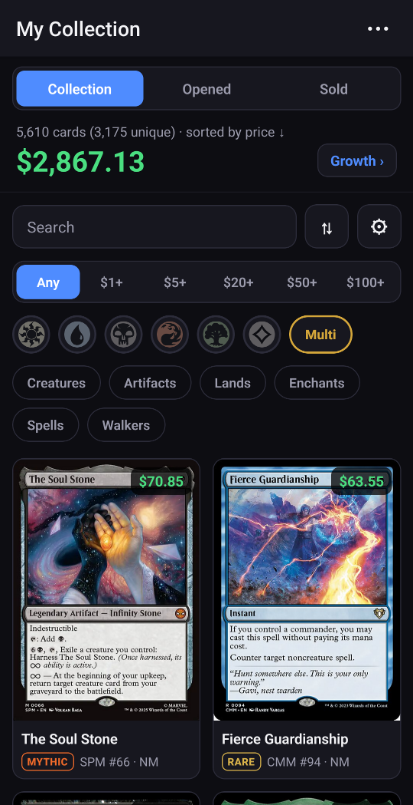
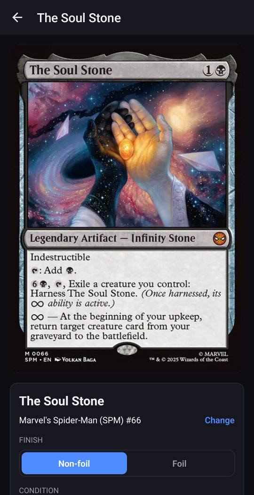
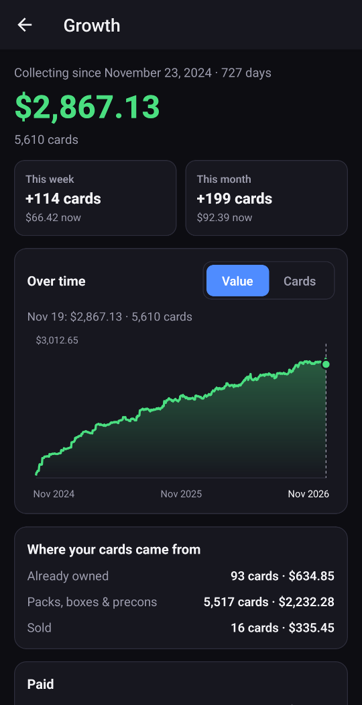
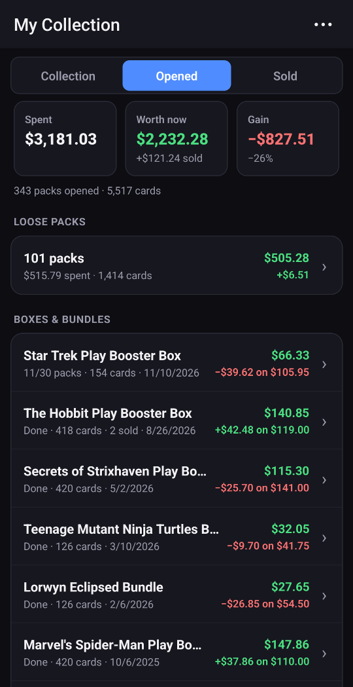
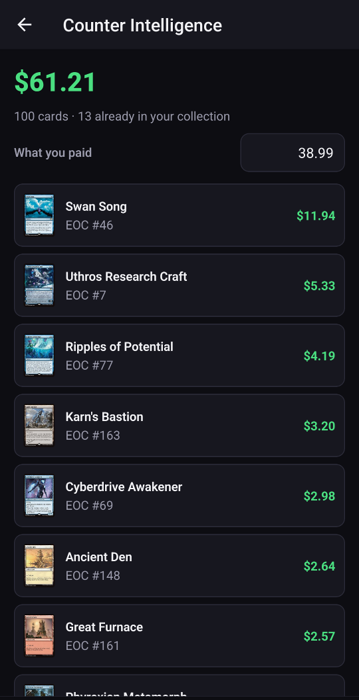
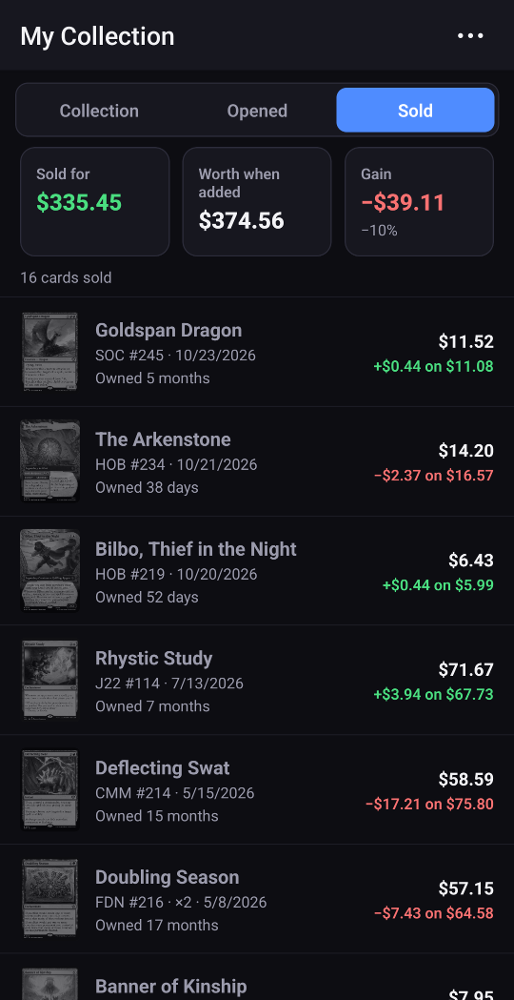

  

<h1 align="center">MTG Collector</h1>

Scan your Magic cards. See what they're worth.

  <a href="https://github.com/bmead92/mtg-collector/releases/latest"><b>Download for Android</b></a>

  

  
  
  

  
  
  

## Features

- Hold cards up to the camera; they're added automatically
- Exact printing (any language), foil and condition, priced from Mana Pool, TCGplayer and Cardmarket
- Import precons, or decks from Moxfield and Archidekt
- Track packs, boxes and precons: what you paid vs what you pulled
- Sell cards and see what you made on them
- Your collection's value over time, and everything you've paid
- Search, filters, export, and automatic backups to your Downloads folder

Free. No account, no ads, nothing collected. Your collection stays on your phone; the app only talks to
Scryfall (cards), MTGJSON (precon lists), Mana Pool (prices) and GitHub (update check).

## Install

1. Download the **.apk** file from the [latest release](https://github.com/bmead92/mtg-collector/releases/latest).
2. Open it and allow the install. Play Protect may warn that it doesn't know the app; install anyway.

Updates install over the old version and keep your cards. Android 8 or newer.

---

MTG Collector is unofficial Fan Content permitted under the Fan Content Policy. Not approved/endorsed
by Wizards. Portions of the materials used are property of Wizards of the Coast. ©Wizards of the Coast LLC.
Card data and images from Scryfall. Precon lists from MTGJSON. Prices from Mana Pool, TCGplayer and Cardmarket. Not affiliated with any
of them. [MIT License](LICENSE).
